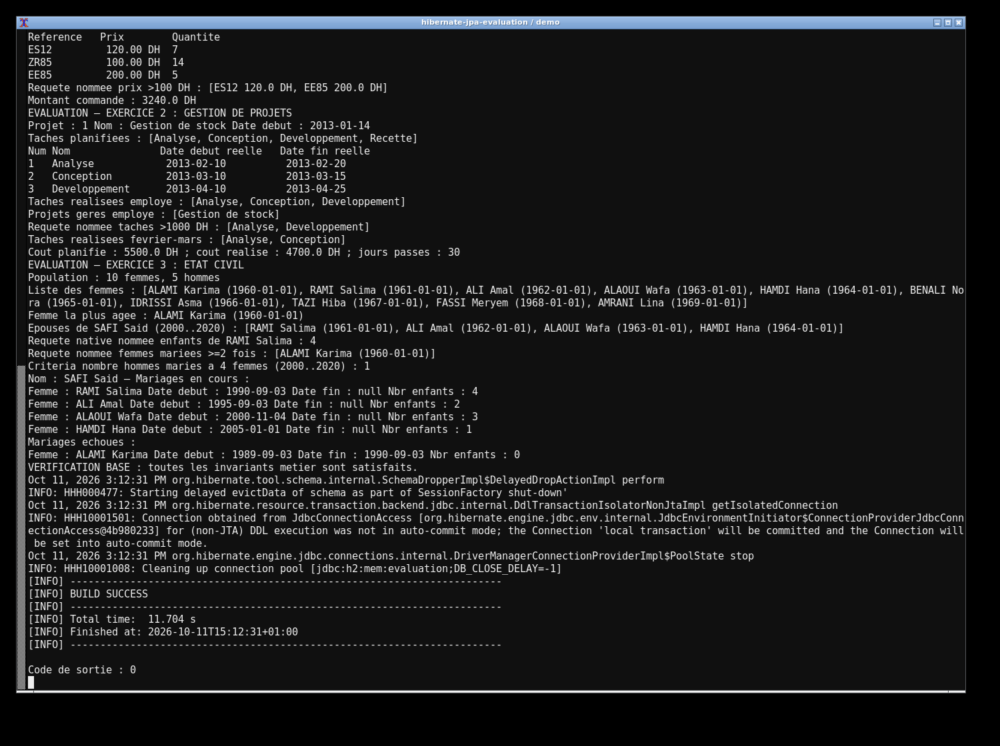
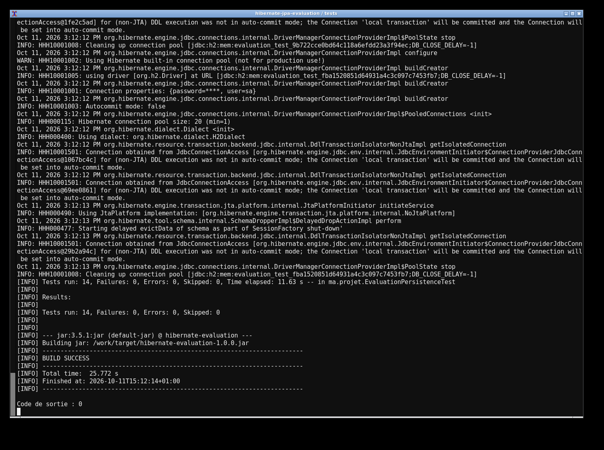
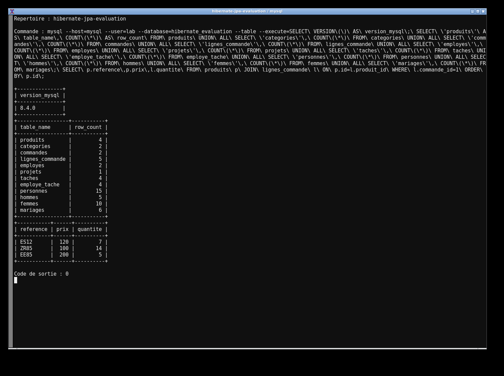

# Évaluation — Stock, projets et état civil

J'ai regroupé les trois exercices de l'évaluation dans ce dépôt. Le projet utilise Java 17, Hibernate et JPA, avec des DAO et des services pour gérer les données.

- **Stock** : catégories, produits, commandes et lignes de commande. Recherches par catégorie, prix et dates.
- **Projets** : employés, projets et tâches. Suivi des dates, des affectations et des coûts.
- **État civil** : hommes, femmes et mariages. Historique, recherche sur une période et requêtes JPQL, SQL native et Criteria.

## Lancer le projet

Avec Java 17 et Maven, la base H2 fonctionne en mémoire :

```bash
mvn clean test
mvn exec:java
```

Pour utiliser MySQL avec Docker :

```bash
docker compose up -d --wait
mvn -Dtest.db=mysql test
mvn -Ddb=mysql exec:java
docker compose down
```

## Résultats

Les 14 tests passent sur H2 et les mêmes 14 tests passent sur MySQL. La démo affiche les résultats des trois exercices. Les sorties et la vérification SQL sont conservées dans [evidence](evidence/).






