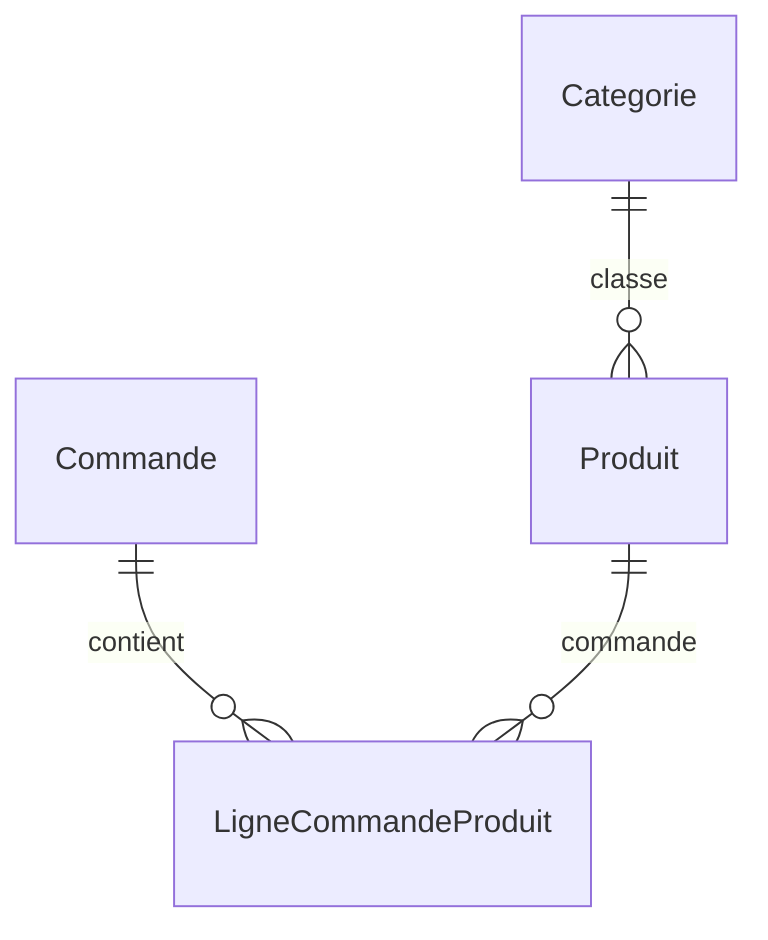
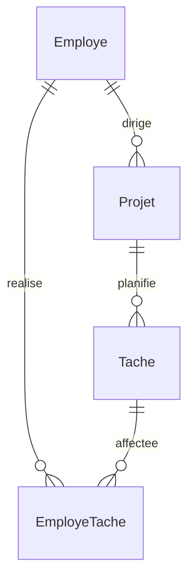
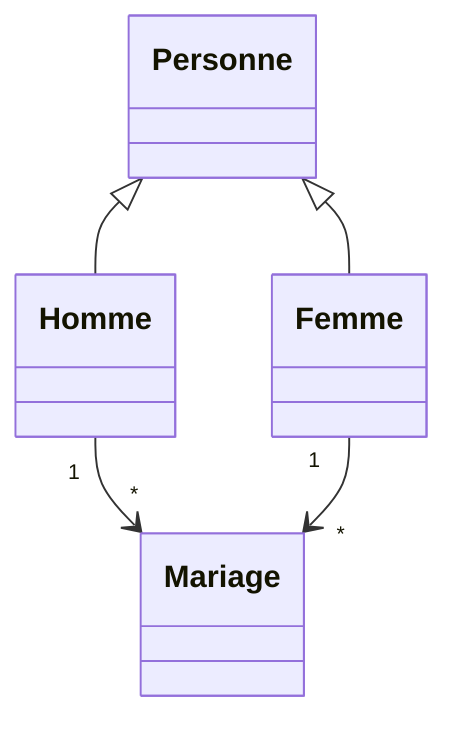

# Structure et relations de la solution

Les trois exercices partagent la configuration et les helpers de transaction, tout en conservant leurs entités et leurs services métier distincts. `ma.projet.dao.IDao<T,ID>` accepte aussi bien un identifiant entier qu'une clé composée.

## Stock

Package `ma.projet.classes`. La clé de ligne est `(commandeId, produitId)` ; la quantité appartient à la ligne. L'identifiant de commande est obtenu à l'insertion et `@MapsId` le propage aux lignes. Les prix produits respectent le type `float` demandé ; le montant est accumulé en décimal.

## Projets

Package `ma.projet.classes`. La clé d'affectation est `(employeId, tacheId)`. Les dates planifiées sont sur la tâche ; les dates réelles sont sur l'affectation. Une tâche est réalisée lorsque sa date réelle de fin est renseignée. Le coût d'une tâche est compté une seule fois dans le coût global réalisé du projet.

## État civil

Package `ma.projet.beans`. L'héritage `JOINED` place les attributs communs dans `personnes` et les identifiants des sous-types dans `hommes`/`femmes`. La clé de mariage est `(hommeId, femmeId, dateDebut)` et distingue les remariages du même couple. Une date de fin nulle indique une union en cours.

Les requêtes sur une période utilisent le chevauchement inclusif des unions. Le nombre d'enfants est celui déclaré pour les unions retenues, puisque le modèle ne comporte aucune entité enfant. Le comptage des quatre épouses utilise une sous-requête Criteria corrélée et `countDistinct(femme.id)`.
